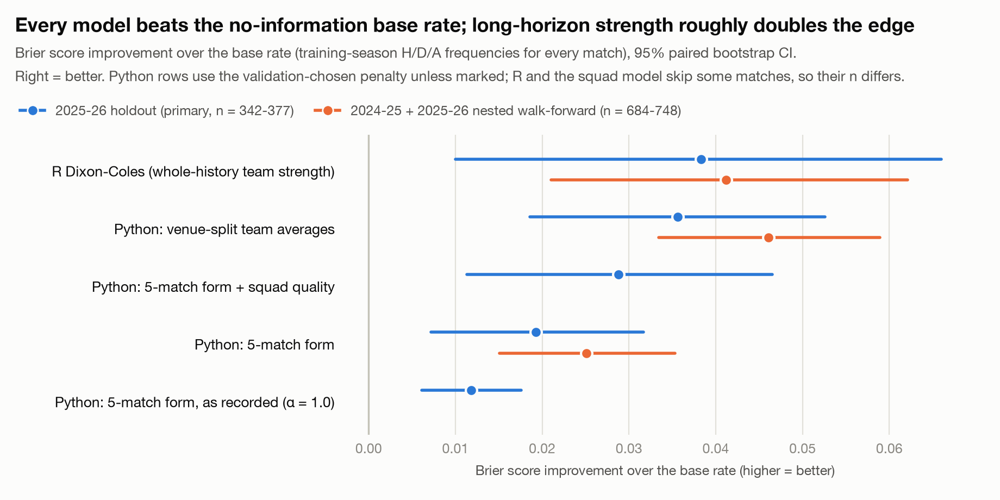
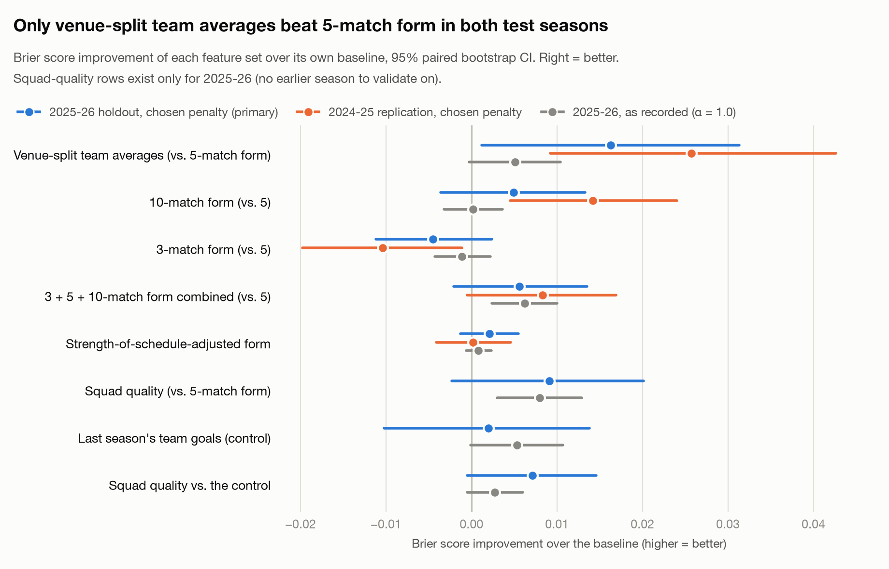
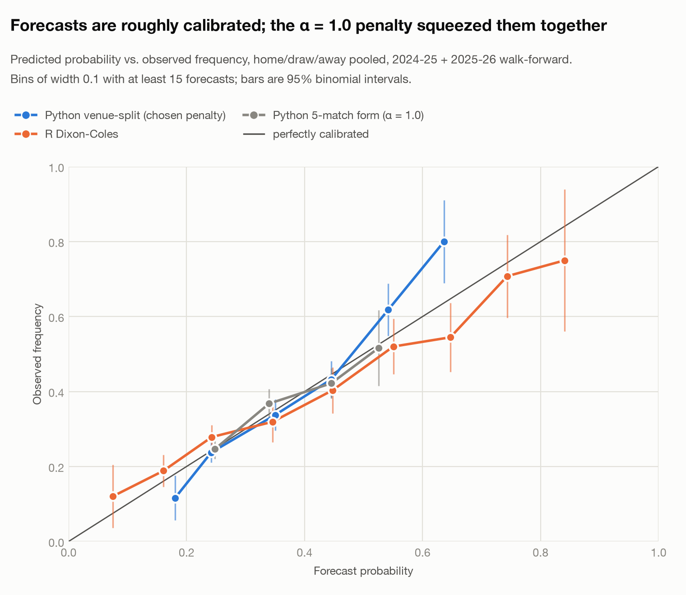
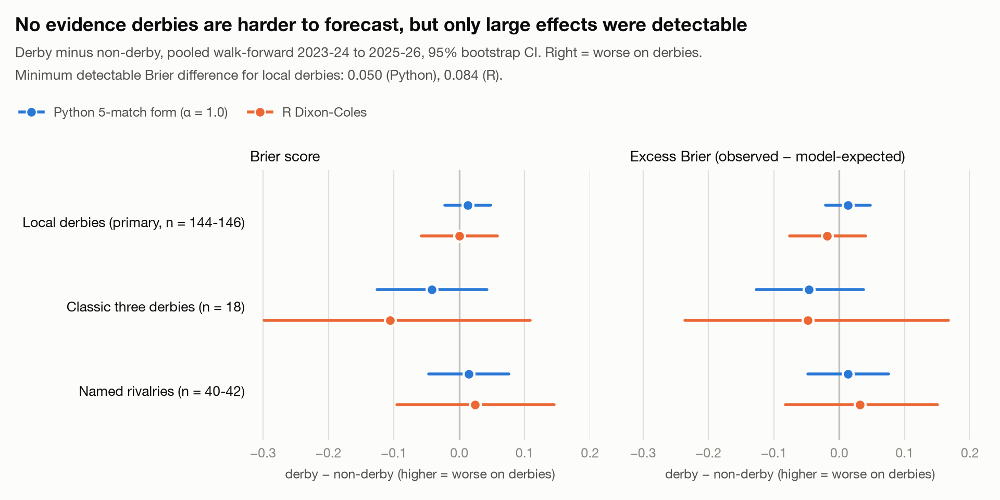

# Soccer Match Forecaster

An out-of-sample study of how well English Premier League results can be
forecast from free historical team and player data, which information
actually improves the forecasts, and whether derbies are harder to call.

**Status: research version frozen** (feature set frozen 2026-10-24; final
evaluation run 2026-10-26). Every number, table and figure below is
regenerated from the committed data by `python run_pipeline.py --reproduce`
([Reproducing](#reproducing)).

## Research questions

1. **How accurately can EPL match outcomes be forecast using historical team
   and player information, and which factors actually improve out-of-sample
   predictions?**
2. **Are derby and rivalry matches systematically harder to forecast than
   ordinary matches?**

## Summary of findings

- **The models know something, but not much.** On seasons they never trained on,
  the best models (an R Dixon-Coles team-strength model and a Python Poisson
  model on venue-split team averages) reach a Brier score of 0.61-0.62. A
  forecast that knows nothing about the teams (the training seasons' home/draw/away
  frequencies) scores 0.657, and a uniform 1/3 guess 0.667. Winner accuracy is
  46-50%, against 42% for always picking the home side. Exact-score accuracy
  (~12%) is no better than always predicting 1-1.
- **Long-horizon team strength is what helps.** A team's whole-history average
  goals scored and conceded *at the same venue* beat 5-match form in both test
  seasons (Brier −0.016 on the 2025-26 holdout, −0.026 on 2024-25). It matches
  R's whole-history team ratings almost exactly (difference −0.001 to
  +0.002). Longer form windows also point the same way, but that isn't
  established.
- **Several plausible features don't help:** a strength-of-schedule
  adjustment (no effect in either season), a shorter 3-match window (worse),
  combining the 3/5/10-match windows, and last season's team goals. Squad
  quality from Wikipedia player data points the right way (−0.009) but isn't
  established.
- **The biggest single effect was a methodological one.** Every result recorded
  during development used one L2 penalty (α = 1.0) on unstandardized
  features. Choosing the penalty properly, inside the training seasons only,
  selected *no* penalty for 8 of the 9 feature sets. Doing so:
  - grew the baseline's edge over the no-information forecast from 0.012 to
    0.019 Brier;
  - turned venue-split from "not distinguishable" into the one established
    effect;
  - removed squad quality's apparently significant +5.6-point accuracy gain,
    which turned out to be an artifact of the penalty, not information.
- **No evidence that derbies are harder to forecast.** Across ~145 out-of-sample
  local derbies per model, neither model scores measurably worse on derbies,
  either raw or relative to what its own probabilities predicted. But this
  test can only detect a Brier gap of 0.05-0.08, which is larger than either
  model's whole edge over a uniform guess. So this is absence of evidence,
  not evidence of absence.

---

## Data

| Source | What | Coverage |
|---|---|---|
| [football-data.co.uk](https://www.football-data.co.uk) | Results, scores and basic match stats (free CSV, no key) | 1,520 EPL matches, 2022-23 to 2025-26 |
| Wikipedia club-season articles via the MediaWiki API | Per-player Premier League appearances and goals | 79 of 80 team-seasons parsed; each checked against the team's actual goals (ratio 0.93-1.00 for nearly all, the gap is own goals) |

- **Bookmaker odds** are in the raw files but are **never used as model
  inputs**. They would leak the betting market's information, and the point
  is to measure what this project's own signals know.
- **Sources evaluated and rejected:** FBref (blocked by Cloudflare), Understat
  (data no longer in the page source). No free injury, lineup or xG source
  was found.
- **Data layers:** raw data is kept byte-for-byte as downloaded (Bronze),
  standardized one row per match (Silver), and turned into model features
  (Gold). Every feature uses only information available before kickoff. Each
  one is shifted so a match never sees its own result, with unit tests
  guarding against leakage.

## Models

- **Python Poisson regression** (`src/models/poisson_model.py`): two
  independent Poisson regressions, one for home goals and one for away goals.
  Each takes the scoring side's attack feature and the opponent's defense
  feature. The two predicted goal rates give a full scoreline probability
  grid, and from it the home/draw/away probabilities.
- **R Dixon-Coles-style GLM** (`src/models/dixon_coles_model.R`): base R,
  fitting `goals ~ home advantage + attack(team) + defense(opponent)` on the
  full match history. It's a genuinely different signal: a fixed strength
  rating per team instead of a regression on recent results. It can't rate a
  team it has never seen, so it skips matches involving newly promoted clubs
  with no history in the data (38 of 380 in 2025-26). It doesn't include the
  original paper's low-score correction (`tau`/`rho`).
- **No-information base rate**: the training seasons' home/draw/away
  frequencies for every match. A model has to beat this to show it knows
  anything about the teams.

### Feature sets tested

Each was tested one at a time against the same baseline, so any change can be
attributed to that feature.

| Feature set | Definition | Question it answers |
|---|---|---|
| **5-match form** (baseline) | Each team's average goals scored / conceded over its last 5 matches | — |
| Venue-split team averages | Average goals scored / conceded over the team's whole history in the data, at the *same venue* only (the home side's home record, the away side's away record) | Does longer-term, venue-specific strength beat recent form? |
| 3- and 10-match form | The baseline with a shorter / longer window | Which form window is best? |
| 3 + 5 + 10-match form | All three windows in one model | Does combining windows help? |
| Strength-of-schedule-adjusted form | Each past result adjusted for that opponent's pre-match strength | Does form over-rate teams that just played weak sides? |
| + Squad quality | The current roster's *previous-season* PL goals / 38 (previous season, so end-of-season totals can't leak) | Does player information add anything? |
| + Last season's team goals (control) | The team's own previous-season goals per match, no player data | Is any squad gain really about players, or just a longer horizon? |

Squad quality doesn't exist for 2022-23, which has no previous season in the
data. So every arm of that experiment, including its baseline, is trained on
2023-24 + 2024-25 only.

## Evaluation design

- **Chronological splits only.** A model is always trained on seasons
  *before* the season it predicts. Data is never shuffled.
- **Primary test: the 2025-26 season** (374-377 matches), scored once in the
  final evaluation.
- **Choosing the penalty without the test season.** Features are standardized
  using the training rows only. Then each feature set's L2 penalty is chosen
  from a grid of 0 to 3 by walk-forward validation inside the training
  seasons: 2023-24 predicted from 2022-23, and 2024-25 from 2022-24. The
  lowest validation Brier score wins.
- **Replication season: 2024-25.** A *nested* walk-forward predicts 2024-25
  from 2022-24, with its penalty chosen on 2023-24 alone. No experiment had
  scored any feature set on it before the final run.
- **Metrics.** Brier score (primary), log loss, winner accuracy, exact-score
  accuracy, and expected-goals error.
- **Uncertainty.** A paired bootstrap over matches (10,000 resamples) gives a
  95% interval for every difference between two models on the same matches.
- **Decision rule, fixed before the final run.** A factor "improves
  out-of-sample predictions" only if its Brier interval against its own
  baseline excludes zero, in the improving direction, on the holdout. The
  replication season checks the direction; it isn't a second chance to
  pass. A Bonferroni-corrected interval for the 8 challengers is reported
  alongside.

Full detail: [docs/METHODOLOGY.md](docs/METHODOLOGY.md).

---

## Results

### 1. How accurately can matches be forecast?

<picture>
  <source media="(prefers-color-scheme: dark)" srcset="docs/figures/model_skill-dark.png">
  
</picture>

**2025-26 holdout** (primary). Each Python row uses the penalty chosen on
the training seasons, which was 0 for every set shown here.

| Model | n | Winner accuracy | Brier | Log loss | Brier vs. base rate [95% CI] |
|---|---:|---:|---:|---:|---|
| Base rate (no team information) | 374 | 42.5% | 0.656 | 1.085 | — |
| Python, 5-match form, *as recorded (α = 1.0)* | 374 | 44.1% | 0.645 | 1.068 | −0.012 [−0.018, −0.006] |
| Python, 5-match form | 374 | 46.8% | 0.637 | 1.056 | −0.019 [−0.032, −0.007] |
| Python, 5-match form + squad quality | 377 | 45.4% | 0.629 | 1.044 | −0.029 [−0.047, −0.011] |
| **Python, venue-split team averages** | 374 | 46.5% | **0.621** | **1.035** | **−0.036 [−0.053, −0.019]** |
| **R Dixon-Coles** | 342 | 47.7% | **0.618** | **1.028** | **−0.038 [−0.066, −0.010]** |

**Pooled 2024-25 + 2025-26 nested walk-forward** (secondary; about twice
the sample).

| Model | n | Winner accuracy | Brier | Log loss | Brier vs. base rate [95% CI] |
|---|---:|---:|---:|---:|---|
| Base rate | 748 | 41.8% | 0.657 | 1.083 | — |
| Python, 5-match form | 748 | 47.7% | 0.632 | 1.048 | −0.025 [−0.035, −0.015] |
| Python, venue-split team averages | 748 | 49.2% | 0.611 | 1.021 | −0.046 [−0.059, −0.033] |
| R Dixon-Coles | 684 | 49.6% | 0.614 | 1.024 | −0.041 [−0.062, −0.021] |

Each "vs. base rate" difference is computed on that model's own matches. R
and the squad model score slightly different match sets, so compare their
rows through that column rather than by raw Brier.

**Reading.**
- Every model beats the no-information forecast on Brier and log loss, so
  all of them carry real information about the teams.
- The long-horizon models have about twice the edge of 5-match form.
- Winner-accuracy gains over "always pick home" (4-8 points) are borderline
  on one season and clear on the pooled sample. Brier and log loss are what
  separate the models from each other.
- Exact-score accuracy (10-13% for every model) doesn't beat the base rate's
  constant 1-1 prediction (12.3%).
- Expected-goals error barely moves (mean absolute error ~1.0 home, ~0.9
  away, for every model): a single match's goal count is mostly noise.

**R vs. Python.**
- R and the venue-split model are statistically indistinguishable: R minus
  venue-split is −0.0006 [−0.014, +0.013] on the holdout and +0.002
  [−0.008, +0.012] pooled.
- Both beat 5-match form by a similar margin. R's lead over it is −0.018
  [−0.043, +0.007] on the holdout and −0.018 [−0.036, +0.001] pooled: close
  to, but not quite, excluding zero.
- The two best models get to the same place by different routes. R fits a
  strength rating per team and adjusts for opponents. The Python model uses
  plain venue-specific scoring averages, can rate a promoted team after a
  few matches, and needs no per-team parameters.

**Frozen model.** By the comparison protocol fixed in advance (a challenger
replaces the baseline only if it wins on Brier without a meaningful accuracy
loss), the frozen Python model is **venue-split team averages, unpenalized**.
R Dixon-Coles is the second, independent model.

### 2. Which factors improve out-of-sample predictions?

<picture>
  <source media="(prefers-color-scheme: dark)" srcset="docs/figures/feature_experiments-dark.png">
  
</picture>

Each column is the change in Brier score vs. that set's own baseline
(negative = better), with a 95% paired-bootstrap interval. **Bold** = the
interval excludes zero.

| Factor | 2025-26 holdout (primary) | 2024-25 replication | As recorded, α = 1.0 (2025-26) | Verdict |
|---|---|---|---|---|
| Venue-split team averages | **−0.0163 [−0.0313, −0.0012]** | **−0.0257 [−0.0426, −0.0092]** | −0.0051 [−0.0104, +0.0003] | **Improves** |
| 10-match form (vs. 5) | −0.0049 [−0.0133, +0.0036] | **−0.0142 [−0.0240, −0.0045]** | −0.0002 [−0.0036, +0.0032] | Suggestive, not established |
| 3 + 5 + 10-match form combined | −0.0056 [−0.0135, +0.0021] | −0.0083 [−0.0169, +0.0005] | **−0.0062 [−0.0100, −0.0024]** | Not established |
| 3-match form (vs. 5) | +0.0045 [−0.0024, +0.0112] | **+0.0104 [+0.0011, +0.0198]** | +0.0011 [−0.0022, +0.0043] | Worse, if anything |
| Strength-of-schedule adjustment | −0.0021 [−0.0055, +0.0013] | −0.0002 [−0.0046, +0.0041] | −0.0008 [−0.0023, +0.0006] | No effect |
| Squad quality (vs. 5-match form) | −0.0091 [−0.0201, +0.0023] | — | **−0.0080 [−0.0129, −0.0030]** | Not established |
| Last season's team goals (control) | −0.0020 [−0.0138, +0.0102] | — | −0.0053 [−0.0107, +0.0001] | No effect |
| Squad quality vs. the control | −0.0071 [−0.0146, +0.0005] | — | −0.0027 [−0.0060, +0.0005] | Not established |

**Venue-split team averages are the one established improvement.**
- They pass the pre-stated rule on the holdout, and they replicate on
  2024-25, a season no earlier experiment had scored them on.
- Log loss agrees (−0.021 [−0.041, −0.0004] on the holdout). Winner accuracy
  doesn't move (−0.3 points).
- The holdout interval alone wouldn't survive a Bonferroni correction for the
  8 challengers ([−0.036, +0.005]). The independent replication is what makes
  the result solid.
- In the fitted model, a one-standard-deviation better home scoring record
  multiplies the home side's expected goals by 1.24, compared with 1.17 for
  5-match form.

**Form-window length.** 10 matches beat 5 and 3 did worse than 5, both
significant in 2024-25 only and in the same direction on the holdout.
Longer windows look better, but by the pre-stated rule that isn't
established. Putting all three windows in one model adds nothing beyond 10
matches alone.

**Squad quality's apparent success was an artifact of the penalty.**
- Under the recorded α = 1.0 it was the project's most promising result: all
  three intervals excluded zero, including +5.6 points of accuracy.
- With the penalty chosen properly, its Brier gain keeps about the same size
  (−0.009) but the interval includes zero, and the accuracy gain becomes −1.1
  points.
- A heavy penalty on unstandardized features shrinks the baseline's
  forecasts toward the base rate. Any extra strength feature lets some of
  that signal back through, which looks like an effect of the feature itself.
- The combined-window set showed the same pattern: "significant" at α = 1.0,
  not with the chosen penalty.

**What choosing the penalty did.**
- Unpenalized fits won validation for every feature set except the
  combined-window one (α = 0.03).
- They improved the holdout Brier score of every set (by −0.004 to −0.019).
  Long-horizon sets gained most: venue-split −0.019, 10-match form −0.012.
- With only 2-3 features and about a thousand training matches there's
  nothing to regularize. The recorded penalty was mostly squeezing the forecasts toward
  the average (figure below).

<picture>
  <source media="(prefers-color-scheme: dark)" srcset="docs/figures/calibration-dark.png">
  
</picture>

**Calibration.**
- All three models are roughly calibrated where most forecasts fall
  (0.2-0.5).
- The α = 1.0 model never forecasts anything outside 0.25-0.55. Its
  P(home win) has a standard deviation of 0.04 across matches, against 0.11
  for venue-split and 0.18 for R.
- R is somewhat overconfident on strong favorites: forecasts of 0.6-0.9 came
  true 55-75% of the time.
- Venue-split is somewhat underconfident at the top: its 0.64 bin came true
  80% of the time.
- The extreme bins hold few matches.

### 3. Are derbies harder to forecast?

<picture>
  <source media="(prefers-color-scheme: dark)" srcset="docs/figures/derby-dark.png">
  
</picture>

**Definitions, fixed in `config.yaml` before any result was computed:**
- **Local** (primary): both clubs in the same metropolitan area, 25 pairings.
- **Classic** (sensitivity): the Manchester, North London and Merseyside
  derbies.
- **Rivalry** (sensitivity): 9 named rivalries, including between-city ones.

**Sample.** Pooled walk-forward predictions for 2023-24 to 2025-26, each
season predicted from the seasons before it.

**Two meanings of "harder".** *Raw loss* is the observed Brier score. *Excess
loss* is the observed loss minus the loss the model expects from its own
probabilities. A model can score worse on derbies just because derbies are
close matchups; the excess version separates that from the model actually
misjudging them.

Local derbies, derby minus non-derby (positive = worse on derbies):

| Model | n derbies | Brier | Excess Brier | Minimum detectable difference |
|---|---:|---|---|---:|
| Python, 5-match form (α = 1.0) | 146 | +0.013 [−0.022, +0.048] | +0.013 [−0.021, +0.048] | 0.050 |
| R Dixon-Coles | 144 | +0.001 [−0.058, +0.058] | −0.019 [−0.076, +0.040] | 0.084 |

- **No interval excludes zero**, under any definition, for either model. In
  the robustness checks, 4 of 70 intervals exclude zero, about the 3.5
  expected by chance, and none is in the "harder" direction.
- **No support for the folklore either.**
  - Derbies don't have more draws: 24.2% vs. 24.1% across all 1,520 matches.
  - Favorites don't underperform in derbies: the two models disagree on the
    sign.
- **Home advantage looks smaller in local derbies, but that isn't
  established.** Home minus away goals is +0.13 per match in local derbies
  vs. +0.30 in other matches; the difference is −0.17 [−0.44, +0.10]. That
  fits shorter travel and shared crowds, but the interval includes zero.
- **The test is badly underpowered.** The minimum detectable difference
  (80% power) is larger than either model's whole skill over a uniform guess.
  Even zero skill on derbies would be detected only about half the time.
- The derby analysis used the α = 1.0 Python model, which was the baseline
  when it ran. It also has a robustness run at α = 0.01, which is close to
  unpenalized: that 5-match-form model's holdout Brier is 0.6372, against
  0.6371 with the chosen penalty. That run gives +0.020 [−0.020, +0.061],
  the same conclusion. R is the more informative test either way.

## Failed and negative hypotheses

Kept deliberately: a feature that doesn't move the forecast is a finding.

| Hypothesis | Result |
|---|---|
| Adjusting form for opponent strength helps | No effect in either test season |
| Shorter (3-match) form captures momentum better | Worse than 5 matches in 2024-25; no better on the holdout |
| Combining 3/5/10-match windows beats any single window | No better than 10 matches alone |
| Last season's team scoring rate adds to current form | No effect once the penalty is chosen properly |
| Squad quality from player data improves forecasts | Right direction, not established; the earlier "significant" result was an artifact of the penalty |
| Derbies are harder to forecast / more often drawn / upset-prone | No support (with a test that could only see large effects) |
| A model can predict exact scores | No better than always guessing 1-1 |
| R's whole-history model is far better (55% vs. 46% accuracy, measured in-sample early on) | Overstated: on held-out data R ties the best Python model and leads 5-match form by a margin not quite distinguishable from zero |

## Limitations

- **Sample size.** One season is ~375 matches, enough to resolve Brier
  differences of ~0.015 but not the ~0.005 effects most features have. Only
  four seasons of data exist here.
- **The holdout has been seen.** Every development experiment reported on
  2025-26, so it influenced which features were tried. It isn't a pristine
  test. That's why the 2024-25 replication matters: no feature set had been
  scored on it.
- **Multiple comparisons.** 8 challengers were tested on the same holdout.
- **Missing inputs.** There is no injury, lineup or xG data, so a team
  missing key players on the day looks the same as at full strength.
- **Roster look-ahead.** Squad rosters come from end-of-season Wikipedia
  articles, so a January signing counts toward the August-December matches
  too. This affects composition only; no results leak.
- **R model.**
  - It skips promoted teams it has never seen (38 holdout matches).
  - It lacks the Dixon-Coles low-score correction.
- **Python model.**
  - It treats home and away goals as independent Poisson counts, with no
    draw adjustment.
  - Despite their names, the `season_avg_*` and `*_by_venue` features are
    whole-history averages; they don't reset each season.
- **Derby analysis.**
  - EPL only (Milan-Inter and Madrid derbies would need other leagues).
  - 86% of local derbies are London derbies, many of them low-intensity.
- **No market benchmark.** Bookmaker probabilities would be the natural
  ceiling to compare against. They were kept out of the models on purpose and
  haven't yet been used even as an evaluation-only reference.
- **The app is behind the research.** The Streamlit app still serves the
  original 5-match-form model with the α = 1.0 penalty (shown next to R's
  predictions). Switching it to the frozen model is an engineering change
  that hasn't been made.

## Future work

Not part of this research version.

- **A truly untouched test.** Score the frozen models on 2026-27 as the season
  is played. No decision in this project has seen those matches.
- **Market benchmark.** Compare against bookmaker closing probabilities,
  as an evaluation reference only, never as an input.
- **Model improvements.**
  - Serve the frozen venue-split model in the app.
  - Add the Dixon-Coles `tau`/`rho` correction.
  - Give R a prior so it can rate promoted teams.
  - Combine venue-split with longer form windows, as a new, separately
    tested experiment.
- **More power.**
  - More seasons, for the feature questions.
  - Serie A / La Liga, for the derby question.
- **New data or methods.** xG and injuries if a free source appears. Random
  Forest / XGBoost only as a research comparison against these baselines.

---

## Reproducing

Tested with Python 3.12.6 (pandas 3.0.5, numpy 2.5.2, scikit-learn 1.9.0,
scipy 1.18.1, matplotlib 3.11.1) and R 4.6.1 with base packages only.

```bash
pip install -r requirements.txt
brew install r                         # or any R >= 4; no CRAN packages needed
python run_pipeline.py --reproduce     # rebuilds every table and figure from the committed data
pytest                                 # 80 tests
```

`--reproduce` never downloads anything. It starts from the raw files committed
in `data/bronze/`, and a clean run regenerates every Silver, Gold, model and
figure file byte-for-byte (checked 2026-10-26). Plain `python run_pipeline.py`
re-downloads the latest data instead; the source revises its files, so that
mode is for live use, not for reproducing these results.

The individual steps, in order:

```bash
python -m src.cleaning.clean_matches          # Bronze -> Silver
python -m src.cleaning.clean_player_stats
python -m src.cleaning.clean_fixtures
python -m src.features.build_match_features   # Silver -> Gold
python -m src.models.poisson_model            # the app's model
python -m src.evaluation.backtest             # recorded experiments (alpha = 1.0)
Rscript src/models/dixon_coles_model.R        # R model: holdout + walk-forward
python -m src.evaluation.derby_analysis       # research question 2
python -m src.evaluation.final_evaluation     # chosen penalty, holdout scored once
python -m src.evaluation.figures              # docs/figures/
```

## Repository layout

```text
config/config.yaml            every setting: seasons, windows, derby definitions, the final-evaluation rules
data/bronze/                  raw downloads, never edited (committed, so results reproduce)
data/silver/                  cleaned matches, player stats, fixtures
data/gold/
  match_features/             model-ready features, one row per match
  prediction_features/        recorded held-out and walk-forward predictions (both models)
  derby_analysis/             every derby interval, per-match scores, pairing tables
  final_evaluation/           penalty selection, final metrics, every paired comparison
src/
  ingestion/  cleaning/       Bronze and Silver
  features/                   Gold features (rolling form, venue split, SOS, squad quality)
  models/                     Python Poisson model, R Dixon-Coles model
  evaluation/                 backtest, derby analysis, final evaluation, figures
docs/
  METHODOLOGY.md              how the data, models and evaluation work, in detail
  PROGRESS.md                 session-by-session research log, including every intermediate result
  figures/                    the figures above (light and dark)
tests/                        80 unit tests, including leakage checks
app.py                        Streamlit app
```

## Streamlit app

```bash
streamlit run app.py
```

An interface to the system, not part of the evidence above. It offers:
- a searchable list of past results, upcoming fixtures and hypothetical
  matchups;
- predicted scores and win/draw/loss probabilities from both models;
- 80%/95% goal intervals and per-team squad views;
- a "Dev View" comparing a past match's pre-match prediction with what
  happened.

See the app note under [Limitations](#limitations).

## Research timeline

All milestones complete. Each one's full write-up is in
[docs/PROGRESS.md](docs/PROGRESS.md).

- [x] **2026-09-26 — Team-level features.** Venue-split averages; no leakage
  (hand check + unit tests).
- [x] **2026-10-03 — Strength of schedule and form.**
  - [x] Strength-of-schedule adjustment
  - [x] 3/5/10-match form compared
  - [x] Combined windows tested (at the freeze)
  - [x] Accuracy, Brier and log loss recorded for each
- [x] **2026-10-10 — Squad quality.** Fixed the player-data parser (57 → 79 of
  80 team-seasons); built the feature with a no-player-data control arm.
- [x] **2026-10-17 — Derby analysis and robustness.** Definitions fixed in
  advance; tested raw and excess loss, calibration by outcome, home
  advantage, robustness, and the power limits of the sample.
- [x] **2026-10-24 — Final research version.**
  - [x] Feature set frozen
  - [x] Penalty chosen inside the training seasons
  - [x] Final chronological backtest, scored once, with a 2024-25 replication
  - [x] Final model and derby comparisons
  - [x] Tables and figures
  - [x] Failed hypotheses and limitations documented
  - [x] One-command reproduction verified byte-for-byte
